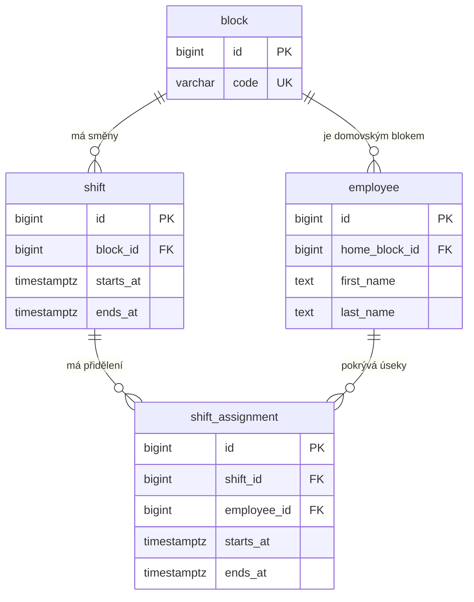

# Datový model rozpisu směn

Diagram zachycuje jádro rozpisu z migrace V1. Migrace V2 přidává příznak
správce bloku, místní účet zaměstnance a kontroly obsazení směn.
Směna určuje, který blok potřebuje obsadit a v jakém čase.
Přidělení směny určuje, kdo pokryje konkrétní časový úsek.

## Proč má přidělení vlastní čas

V [ukázkových datech](../dev/demo.sql) mají bloky A a B směnu od 14:00 do 22:00.
Anna patří do bloku A. Od 14:00 do 19:00 pracuje na bloku A a od 19:00
do 22:00 zaskakuje na bloku B. Oba úseky jsou uloženy v `shift_assignment`.
Její domovský blok zůstává A. Z těchto časů lze určit, které části obou směn ještě zbývá obsadit.

## Co kontroluje databáze

- Kód bloku je jedinečný a má jednu z hodnot A až F.
- Každý zaměstnanec má právě jeden domovský blok. Směnu lze založit i bez přidělení.
- U směny i přidělení musí být začátek před koncem.
- Přidělení jednoho zaměstnance se nesmějí časově překrývat ani mezi různými bloky.
  Konec jednoho úseku může být začátkem dalšího, jako při předání v 19:00.

- Od V2 se v jedné směně nesmějí překrývat ani úseky dvou různých zaměstnanců.
- Přidělení musí celé ležet uvnitř směny. Databáze kontroluje také změnu času
  již obsazené směny. V2 odmítne existující neplatná data. Chybu lze dohledat
  porovnáním intervalů v tabulkách `shift_assignment` a `shift`.
- Každý blok může mít nejvýše jednoho správce. Oprávnění k přidělení se ověřuje
  podle bloku směny. Domovský blok přiděleného zaměstnance se nemění.

## Zkrácení směny během přidělování

Směna končí ve 22:00. Jeden požadavek přiděluje úsek 19:00–22:00 a druhý
současně posouvá konec směny na 21:00. Při vkládání přidělení si databáze
zamkne řádek směny pro čtení (`FOR SHARE`). Změna času potřebuje na stejném
řádku zámek pro zápis. V režimu `READ COMMITTED` proto záleží na pořadí:

- Pokud se nejprve uloží přidělení, databáze odmítne zkrátit obsazenou směnu.
- Pokud se nejprve uloží kratší směna, databáze odmítne přidělení do 22:00.

Obě pořadí ověřuje [integrační test](../backend/src/test/java/cz/tul/reception/assignment/ConcurrentAssignmentTest.java).
