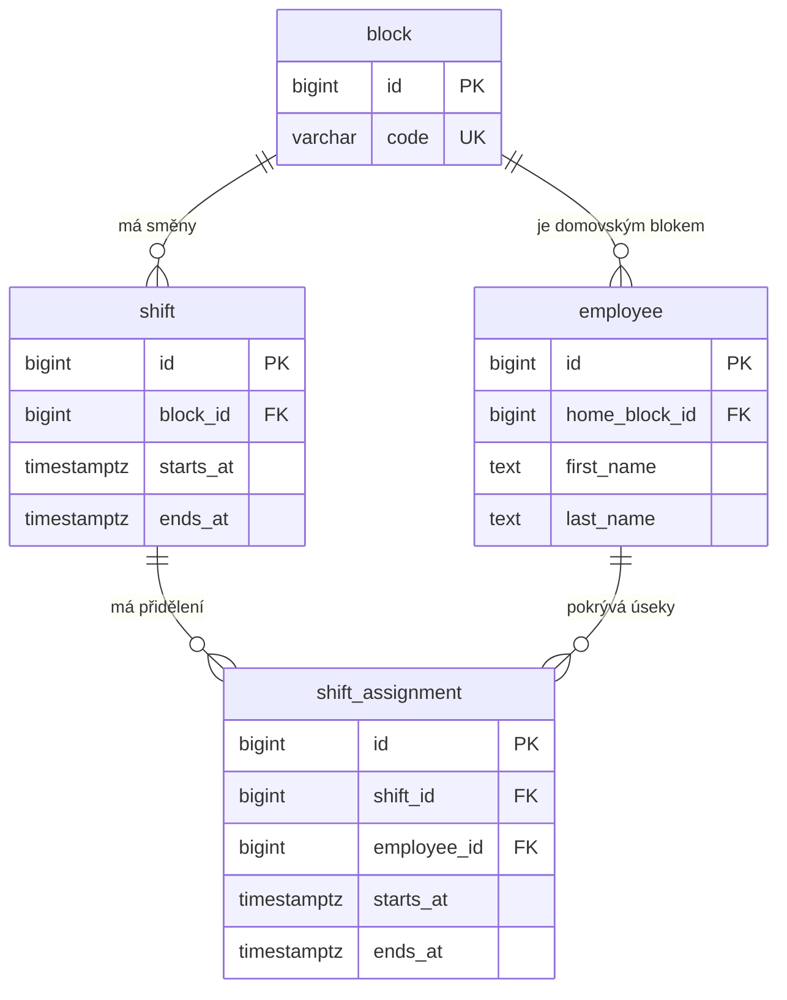

# Datový model rozpisu směn

Model odpovídá [migraci V1](../backend/src/main/resources/db/migration/V1__create_schedule_core.sql).
Směna určuje, který blok potřebuje obsadit a v jakém čase.
Přidělení směny určuje, kdo pokryje konkrétní časový úsek.

## Proč má přidělení vlastní čas

V [ukázkových datech](../dev/demo.sql) mají bloky A a B směnu od 14:00 do 22:00.
Anna patří do bloku A. Od 14:00 do 19:00 pracuje na bloku A a od 19:00
do 22:00 zaskakuje na bloku B. Oba úseky jsou uloženy v `shift_assignment`.
Její domovský blok zůstává A. Z těchto časů lze určit, které části obou směn ještě zbývá obsadit.

## Co kontroluje databáze

- Kód bloku je jedinečný a má jednu z hodnot A až F.
- Každý zaměstnanec má právě jeden domovský blok. Směnu lze založit i bez přidělení.
- U směny i přidělení musí být začátek před koncem.
- Přidělení jednoho zaměstnance se nesmějí časově překrývat ani mezi různými bloky.
  Konec jednoho úseku může být začátkem dalšího, jako při předání v 19:00.

Kontrola, že přidělený úsek celý leží uvnitř příslušné směny, v migraci V1 zatím chybí.
